# CentroTareas

App Android hecha con Kotlin, Jetpack Compose y Material 3 para el Laboratorio N.º 14 "Hilos en Android" (Programación en Móviles, Tecsup).

## Descripción

CentroTareas muestra, en una sola pantalla con tres tarjetas, cómo trabajar con corrutinas sin congelar la interfaz:

- **Tarea con progreso:** una tarea larga con barra de progreso que se puede cancelar.
- **Contar números primos:** un cálculo pesado en segundo plano, cancelable.
- **Dos cargas:** compara cargar datos una por una contra cargarlos a la vez con `async`, con manejo de errores y botón para reintentar.

## Árbol de paquetes

```text
com.lajara.centrotareas
├── MainActivity.kt
├── model
│   └── Estados.kt
├── data
│   ├── TareasRepository.kt
│   └── TareasRepositoryLocal.kt
├── viewmodel
│   ├── TareasViewModel.kt
│   └── TareasViewModelFactory.kt
└── ui
    ├── PantallaTareas.kt
    └── theme
        ├── Color.kt
        ├── Theme.kt
        └── Type.kt
```

## Diagrama MVVM

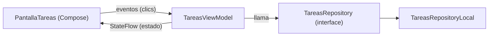

La pantalla solo dibuja el estado y avisa de los clics. El ViewModel guarda el estado en `StateFlow` y lanza las corrutinas con `viewModelScope`. El Repository hace el trabajo pesado y no conoce la pantalla.

## Observación del Paso 1

Al pulsar "Tarea larga (MAL)" la pantalla se congela 4 segundos y los toques no responden, porque `Thread.sleep` detiene el hilo principal, que es el que dibuja la pantalla y atiende los toques. Por eso `Trabajando...` no llega a verse: Compose no puede redibujar hasta que termina la espera, y para entonces el mensaje ya cambió a `Terminó`. Con una espera de 10 segundos, Android mostraría el aviso "La aplicación no responde" (ANR); en mis pruebas lo vi al encadenar varios toques.

## Capturas

**1. Tarea con progreso**

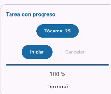

**2. Tarea cancelada**

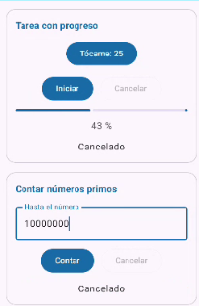

**3. Contar números primos**

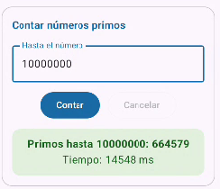

**4. Una por una contra A la vez**

| Una por una (≈ 5 s) | A la vez (≈ 3 s) |
|---------------------|---|
| 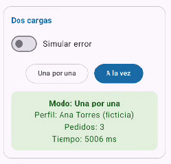 | 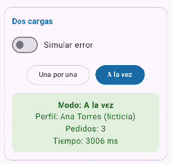 |

**5. Error con reintento**

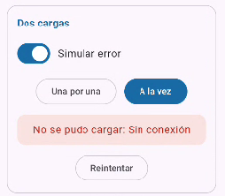

**6. Screen Completa**

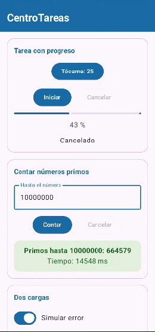

## **FASE 2 - Mejora con IA**

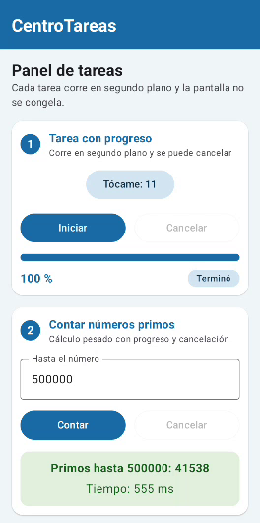

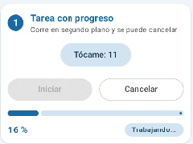

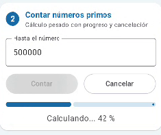

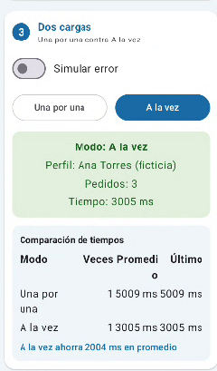

## Para pensar

**1. ¿Por qué no se veía `Trabajando...` en el Paso 1?**
Porque `Thread.sleep` bloqueaba el hilo principal. Compose solo puede redibujar cuando ese hilo queda libre. El mensaje cambió a `Trabajando...` y 4 segundos después a `Terminó`, sin que se dibujara ningún cuadro en medio. Solo se alcanzó a ver el último valor.

**2. ¿Qué diferencia hay entre `Thread.sleep` y `delay`?**
`Thread.sleep` detiene el hilo completo: mientras espera, ese hilo no puede hacer nada más. `delay` solo suspende la corrutina y deja el hilo libre para otras tareas; cuando pasa el tiempo, la corrutina continúa. Además, `delay` revisa si la corrutina fue cancelada.

**3. ¿Por qué `Dispatchers.Default` para los primos y `Dispatchers.IO` para la red?**
`Default` tiene tantos hilos como núcleos tiene el procesador y sirve para cálculos que usan mucho CPU, como contar primos. `IO` tiene muchos más hilos y sirve para tareas que pasan casi todo el tiempo esperando (red, disco). Si se usara `Default` para la red, unos pocos hilos quedarían ocupados esperando respuestas y el resto del trabajo se retrasaría.

**4. ¿Qué pasaría con la corrutina si el usuario cierra la pantalla? ¿Qué papel cumple `viewModelScope`?**
`viewModelScope` está atado a la vida del ViewModel. Si el usuario cierra la pantalla de forma definitiva, el ViewModel se destruye y las corrutinas se cancelan solas, así no queda trabajo inútil ni fugas de memoria. Si solo rota la pantalla, el ViewModel sobrevive y la tarea continúa.

**5. ¿Por qué `async` tarda 3 s y no 5 s? ¿Qué pasa si una de las dos cargas falla?**
Con `async` las dos cargas empiezan al mismo tiempo, así que el total es lo que tarda la más lenta (3 s) y no la suma de ambas (2 s + 3 s = 5 s). Si una falla, `coroutineScope` cancela a la otra y relanza la excepción; el `try/catch` la atrapa y la pantalla muestra el recuadro de error con el botón **Reintentar**.